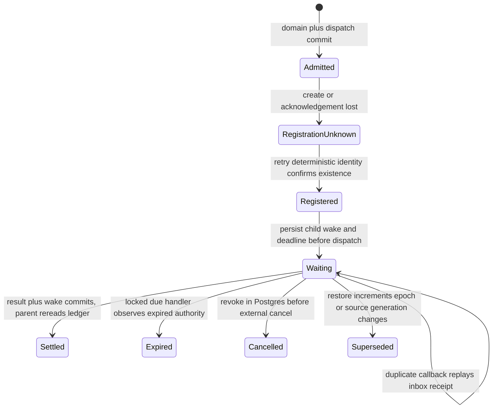
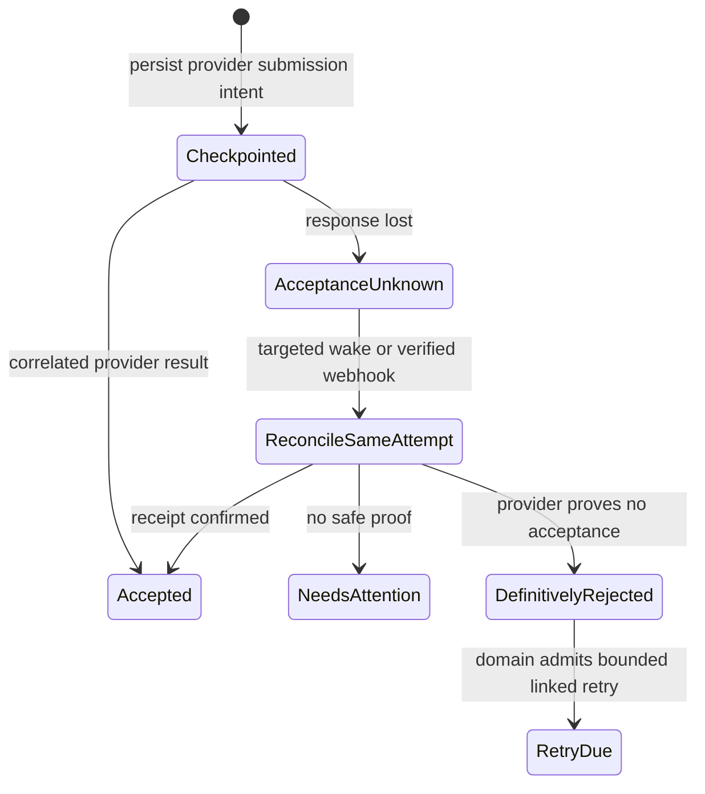
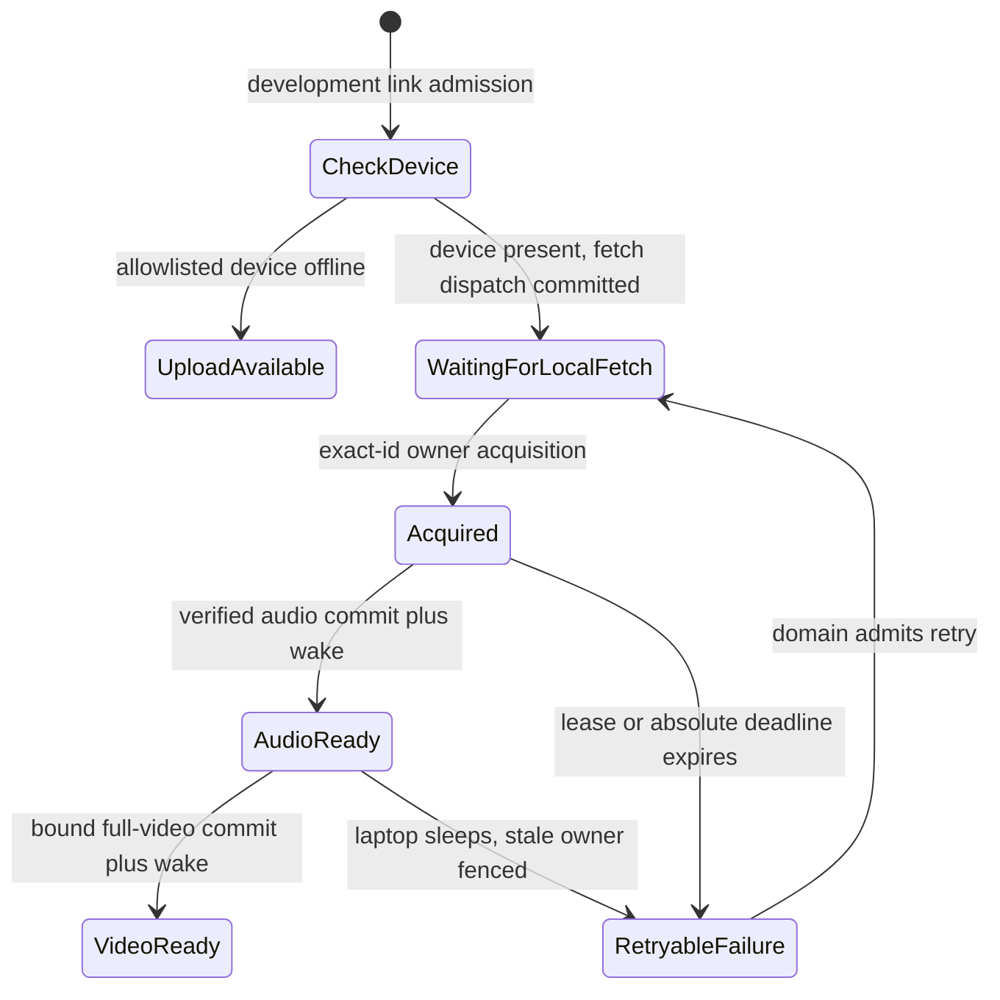

# Postgres owns execution; Workflows schedules it

**Status:** accepted design, 2026-10-31. Deployment requires the single integrated cutover in [the specification](../../.scratch/serverless-cutover/spec.md). Contract acceptance does not authorize an incomplete runtime cutover.

Narriflow replaces always-on API and worker processes with a Cloudflare Worker, durable Workflows and short-lived Modal media functions. Postgres remains the only authority for admission, credits, domain attempts, ownership, publication and settlement. The browser remains an API client. The laptop can execute development YouTube acquisition through an outbound connection; it has the same narrow executor authority as Modal and no database credential.

## Scheduling and domain authority

A domain transition inserts its Execution Dispatch obligations in the same transaction. A dispatch records destination kind, subject kind and ID, subject generation, deployment epoch, immutable input hash, deterministic delivery key, due and next-delivery times, delivery ownership, acknowledgement and bounded failure facts. It contains references only. Workflow Event remains Project progress/history; Workspace Event remains the integration feed. Neither event log is repurposed as a scheduler ledger.

Destination kinds are `import_pipeline`, `render_run`, `operation_driver`, `maintenance`, `project_progress`, `local_fetch` and `modal_execution`. The destination is separate from the domain subject and the command action. Worker entrypoints and Workflow steps resolve a fresh scoped Prisma client through uncached Hyperdrive, inject it, then close it in `finally`. No connection, transaction or claim crosses a durable sleep. Static health and Durable Object keepalives open no database connection.

After commit, delivery confirms registration using an instance ID derived from epoch, kind, subject and generation, hashed to at most 100 characters. Confirmed creation or confirmed existence acknowledges registration. Ambiguous delivery remains unacknowledged and replays the same key. Acceptance returns only after registration is confirmed; a retryable response retains the same Operation Receipt or Upload Session identity. `waitUntil` accelerates delivery but is not its guarantee. Before child dispatch, persist its parent wake and deadline obligations. Result, wake and event publication obligations commit together. An hourly bounded indexed scan repairs abandoned delivery gaps; an hour of recovery is an availability failure.

A Workflow orchestrates dispatch, waits and deadlines. Every step rereads the domain ledger. A completed step, external call result or Workflow instance is never mutation authority and never creates another charged attempt. Selection windows persist results by reference, with one global finalization; frozen Render Work Set membership still determines parent settlement. The parent has no lease while awaiting children; child commits never settle the parent.

## Fencing and lock order

Workspace usage advisory lock precedes Project admission lock. When required, domain rows follow in deterministic order: parent Workflow Run, Render Group, member, variant. Domain-specific locks retain their existing ordering. Event sequence counter locks remain last, as in ADR 0014. Observe database time after locks with `clock_timestamp() AT TIME ZONE 'UTC'`, never transaction-start or process time.

Every external mutation compares current deployment epoch, subject generation, immutable input hash, existing domain attempt token, executor owner, live lease and allowed action. Domain cancellation or supersession revokes this authority in Postgres before best-effort external cancellation. A restore increments the deployment epoch before redispatch, fencing all earlier executors and device sessions.

Execution Attempt stores executor ownership for an already admitted domain token; it is not a new domain attempt or retry budget. Atomically acquiring one owner is mandatory before expensive work. Two owners cannot both acquire the same token. A duplicate invocation gets the recorded disposition and starts nothing. The owner records process start only after successful real process startup and cannot proceed if recording start fails. Domain start accounting is idempotent. Acquisition and pre-start rejection are uncharged. Existing Ingest Claim and Render Group history, membership and charge ledgers remain authoritative and are not replaced by transport delivery counters.

A renewable lease, absolute operation deadline, provider-submission deadline, provider-result deadline and retry `dueAt` are distinct facts. A heartbeat renews only active work and cannot extend the absolute deadline. The Workflow watchdog wakes at its prior due time with epoch, generation, token and observed deadline, locks, reads DB time and either no-ops, sleeps to a renewed deadline or invokes the same domain expiry transition used by the hourly safety scan. Renewal does not schedule another timer. Ownership loss kills the executor process group.

## Executor control and immutable artifacts

[The strict schemas](../../packages/validators/src/execution.ts) define `acquire`, `renew`, `process-start`, `read-disposition`, `commit-artifact`, `fail`, `release` and `progress`. The 64 KiB command and reference envelope limit is enforced before parsing by adapters. No transcript, caption text, credentials, signed URLs or media goes into Workflow state, dispatch rows or diagnostics. A reference is `{dispatchId, deploymentEpoch, kind, subject: {kind, id}, generation, inputHash}`. A fence adds the existing domain `attemptToken` and invocation `owner`.

Sign HMAC-SHA256 version 1 with a distinct key ring per direction: Worker to Modal, executor to Worker, and development device. The signed message is the UTF-8 encoding of these fields joined by a single LF, with no trailing LF: `version`, `keyId`, `audience`, uppercase method, canonical target, lowercase body SHA-256 hex, Unix-seconds timestamp, delivery UUID. Canonical target is pathname plus query, with query pairs sorted by name then value and encoded using RFC 3986 unreserved bytes only. Paths must already be canonical, with no dot segments, repeated slash or percent-encoded slash. Verification compares exact request method and target, hashes the raw body, validates the expected audience and active key ID, and compares signatures in constant time. Reject timestamps beyond the 300-second absolute clock window before mutation. An exact durable inbox receipt replays the committed disposition; the same audience/delivery ID with another canonical request digest is a conflict. Signature validity alone grants nothing.

The authenticated Python Modal bridge accepts a reference-only spawn/status/cancel command. A lost spawn acknowledgement can cause another container, so `.spawn()` and `retries=0` cannot replace executor acquisition. Artifact grants name server-assigned, invocation- and attempt-unique private destinations. A commit supplies an assigned artifact ID, role, measured content type, byte length, SHA-256, ETag and binding hash. The service resolves the assigned namespace and HEADs the object before publishing through all fences. It never accepts a callback-selected key, URL or Workflow ID. An ambiguous commit is resolved through `read-disposition`; the executor cannot infer that the object is unreferenced and delete it.

## Source Audio and media ownership

Source Audio is immutable whole-source audio evidence bound to Project, source revision, normalized upstream media identity, selected track, exact private object identity, byte length and hash, whole-source probed duration, probe version and toolchain fingerprint. Verified audio may admit Scribe before full video completes; it never marks `ingestStatus=ready`. Admission locks Workspace usage, validates the current binding, compares the exact duration with the plan cap before whole-credit rounding, settles usage once and admits STT plus dispatch together. The language probe runs only after this admission.

Full video must match media identity, source revision, selected audio track, offsets and duration within `max(1 second, 2 frames)`. That tolerance cannot change a credit debit or admit an over-cap source. Mismatch fails `source_audio_video_mismatch`; unsettled usage releases, settled usage stays and records operator-refund-needed evidence. Whole-source audio, audio-only inputs, supplied captions and no-STT paths keep the current product contract. No SourceRange model or range-only acquisition is introduced.

The TypeScript renderer, composition plan, caption cue derivation and normalized ffprobe parser remain single implementations. They move to `apps/media`; Python owns only downloading, detectors and Modal glue. Source identity and complete-window evidence bind preparation reuse. Native processes, file transfer and arbitrary guarded URLs run in lean or render Modal images. Worker code performs only storage signing/HEAD/multipart control and known-origin provider requests. R2's 10 GiB source cap uses multipart beyond single-PUT capacity. Large pinning uses conditional ranged GET into unique multipart output, aborts on any identity failure, and publishes only after target verification. Grantable originals remain held until grants expire.

## Progress and external delivery

ProjectProgress uses hibernating WebSockets with a one-use 30-second connect ticket and a 60-second maximum subscription. Scope, Origin, actor, audience, nonce, expiry and cursor are persisted in the socket attachment. The DO consumes the nonce before upgrade, uses one earliest-expiry alarm and receives immediate membership/restriction/deletion revocations. Subscribe-buffer-replay merges committed events through a high-water mark, deduplicates sequence numbers, catches gaps and resets beyond retention. A healthy stream and idle local-agent socket perform zero SQL polling.

Publication wakeups bind the exact post schedule revision. Waking rechecks frozen export, editor, account, grant, cancellation and same-attempt provider identity. Pending or unknown acceptance reconciles that operation; unrecoverable unknown becomes Needs attention. It never blindly creates another post. Completion Callback and Webhook Subscription dispatches use the guarded `outbound_delivery` function. Each subscription advances its own cursor only after 2xx. Terminal transitions, Finishing, quota effects and follow-up admission remain transaction-owned.

## Failure state diagrams

## Alternatives and source patterns

The [Cloudflare Workflows starter](https://github.com/cloudflare/workflows-starter) provides durable step scheduling; the [hibernation example](https://github.com/cloudflare/cloudflare-docs/blob/production/src/content/docs/durable-objects/examples/websocket-hibernation-server.mdx) provides incoming-socket lifecycle and attachments. [Modal's examples](https://github.com/modal-labs/modal-examples/blob/main/07_web/discord_bot.py) show a small web function spawning longer work. [yt-dlp](https://github.com/yt-dlp/yt-dlp) provides shared extraction, config isolation and proxy support. These are platform examples, not Narriflow domain authority; the database fences and receipts above supply that authority.

We reject a generic SQL tunnel to executors, database polling inside Workflows, one timer per heartbeat, a parent lease spanning waits, platform retries as domain retries, signed URLs in durable messages, a second renderer, dual runtime cutover, legacy passcode readers and concurrent schedulers against one database. The [complete loop inventory and deletion map](../serverless-execution-inventory.md) assigns every old loop a trigger, retry and expiry owner. The deletion-inclusive candidate passes all real-platform and crash gates before the single routing switch; failed gates keep admission closed and old credentials fenced.
