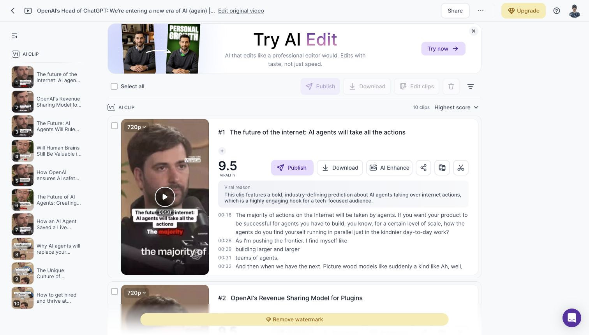
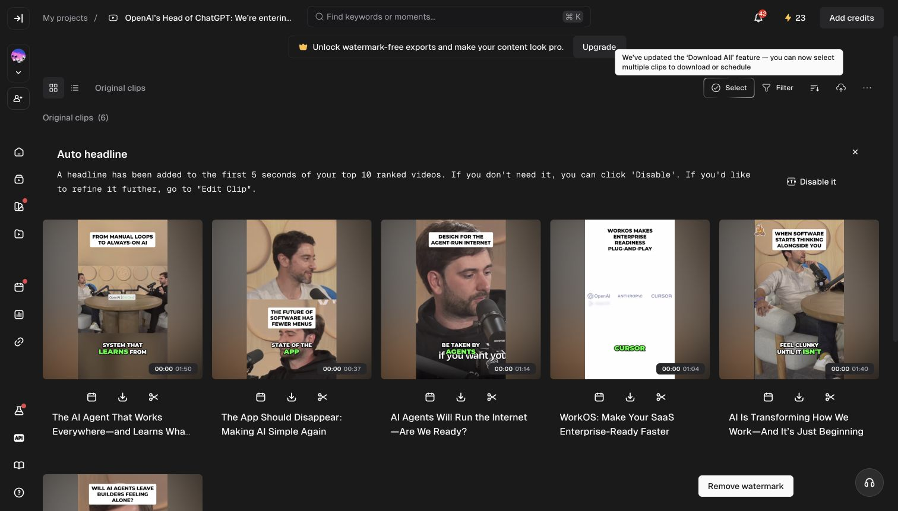
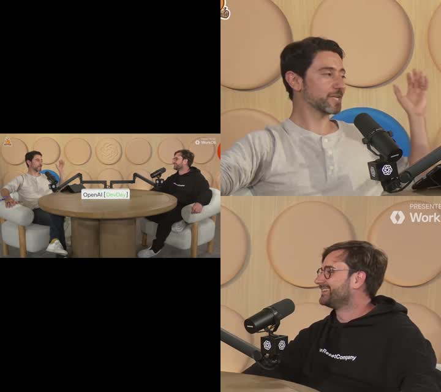
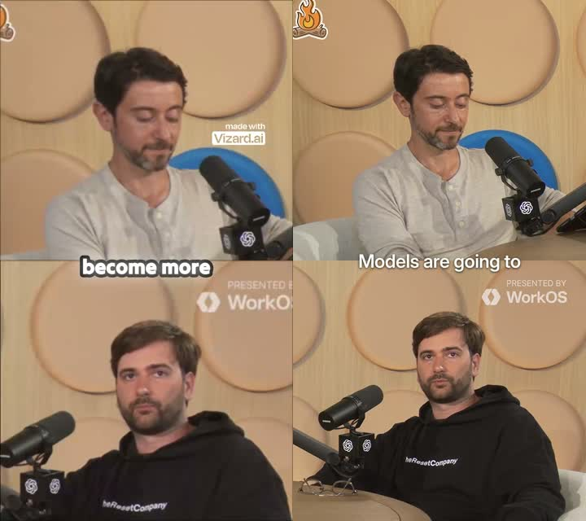
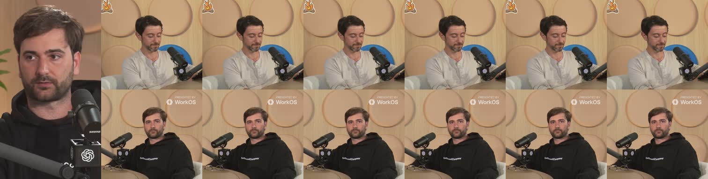

# Clip framing comparison, October 25, 2026

The supplied 37:23 video exposed three concrete Narriflow defects: a 0.8-second Fit flash after a camera cut, loose stacked speaker crops, and default captions covering the lower speaker after tightening the crop. All three are fixed in the local code and verified against rendered footage. Automatic moment selection remains blocked by exhausted OpenAI API credits, as requested after the initial run failed. No deployed application was updated.

## Test conditions and timing

Source: [the supplied YouTube video](https://www.youtube.com/watch?v=MM-C3JqCXBk). The ingested source is 1920×1080 at 60000/1001 fps, with a measured duration of 2242.839 seconds. Each product received the full link and a 9:16 target through the existing logged-in Chrome session.

| Product | Available configuration | Result | Observed elapsed time |
| --- | --- | --- | --- |
| [Vizard](https://vizard.ai/project/35601686) | Free account, v1, Default captions, any clip length, 37 credits | 10 clips; downloaded output is 720×1280 | Ready by 7m 14s after generation submission |
| [Opus](https://clip.opus.pro/clip/P3102514Sq3A) | Free account, ClipBasic, Simple captions, auto zoom off, Auto 0–3m, 37 credits | 6 clips; inspected preview is 406×720 | Still processing at 13m 35s; ready by 16m 45s |
| Narriflow | 10 requested clips, Auto length, brand default captions | Import and transcription completed; detection failed with `openai_quota_exhausted` | Ingest took 86.2s; transcription completed 2m 25s after project creation |

The competitor times are completion observation bounds, not exact server completion timestamps. Vizard v2 required an upgrade and was not used. The products' default clip-length policies differ, so clip counts and speed do not establish equal-quality throughput. Opus's final downloaded export resolution was not checked; its inspected file is a browser preview.

## Audit steps

1. **Source and setup, healthy.** Imported the same full source into all three products. Inspected a six-second sampling of the opening three minutes and a thirty-second sampling across the full video. The source alternates between each speaker's close-up and a wide two-person shot. It also contains title cards, sponsor graphics, and an opening teaser with captions already burned in.
2. **Vizard generation and output, completed with quality issues.** Captured the 10-clip result page and downloaded clips 1 and 3. Camera cuts become close-up or stacked crops; stacked speakers remain large and captions sit near the tile seam. Clip 1 repeats the teaser's existing captions beneath the generated captions. The displayed transcript also contains recognition mistakes. A high virality score does not make that clip ready to publish.
3. **Opus generation and output, completed with quality issues.** Captured all six result cards and inspected the first clip's downloaded preview across its 110.6-second duration. It alternates between close-ups and crops of a speaker seated at the table. Several wide-camera crops retain substantial chair/table area. One selected clip is the WorkOS sponsor segment. The result grid also shows an opening-teaser selection with duplicated source captions.
4. **Narriflow generation, blocked; framing fixes, verified.** Preserved the failed automatic-selection state. Used the completed source and transcript for local framing and caption tests. Rendered three source windows totaling 136.3 seconds, including camera cuts and speaker handoffs. The final review sample is a manually selected complete answer, not an automatically discovered or scored clip.

## Fixes and evidence

### Camera-cut tracking reset

At source time 104.933 seconds, FFmpeg reports a cut at clip-relative 14.933333 while the face detector reports the corresponding sample at 14.933. Face-track admission previously reset at the next sample, discarding a valid continuation. This produced Fit from 14.933 through 15.733 before the stacked layout appeared.

Track resets now use the same millisecond precision as detector samples. Shot boundaries retain source-frame timing. A minimized regression failed before the fix and passes afterward. Replaying all 225 detector samples from the 60-second window now yields four camera scenes instead of five, with no transient Fit scene. Confidence thresholds remain unchanged, preserving rejection of the static plant/sign false positive in the same footage.

### Speaker crop size

The 1.1 zoom ceiling prevented the existing 26% face-height target from working on wide podcast shots. An observed face height of 0.11 filled only 12.1% of a stacked tile. Automatic analysis now permits up to 2.5 zoom, still choosing zoom from the shot median and keeping it constant within the shot. Crop tracks move the framing without changing its size. Existing large close-ups remain at zoom 1.

This changes the policy recorded in ADR 0004. Original source identity and dimensions still bind the evidence; proxy resolution cannot select different preview and export framing. Tight crops can reveal limited source detail, so a 1080 export should not be mistaken for newly recovered image detail.

The 60-second replay checked 308 matched speaker-face observations against the planned crops. Their detected face boxes remained fully inside the crop, within floating-point tolerance. This checks detector boxes at sampled frames, not every decoded frame or hair/hand boundaries.

### Caption placement

Tighter stacked crops put the lower face near 71% of the full canvas, almost exactly behind the default 72% caption anchor. The shared composition planner now places default bottom cues touching stacked speaker scenes at the actual tile seam. Explicit Y coordinates, top/center presets, single-speaker scenes, and square targets retain their selected behavior. Cue text, grouping, and timing still come from the existing shared caption model.

The change lives in the planner; Studio and ASS burn-in consume the same planned anchor. Regression cases cover default positioning and explicit user choices. Both the saved composition plan and encoded video confirm the correction.

## Rendered review sample

[Play the final 34.2-second Narriflow sample](../../artifacts/clip-comparison-2026-10-25/narriflow-final-sample.mp4), 1080×1920 with audio and canonical Focus captions. The source window is 31:00.8–31:35.0. It begins just before the answer and ends after the final sentence, before the next question. No virality score is assigned to this manually selected sample.

Local analysis took 0.971s and encoding took 6.957s. These measurements exclude source acquisition, transcription, automatic moment selection, uploads, and queue delay. They cannot be compared directly with the competitors' end-to-end generation times.

## Verification and limits

- `bun run lint` passed with 13 existing warnings and one informational diagnostic.
- `bun run typecheck` passed for all 13 tasks.
- `bun run test` passed for all eight tasks on the final rerun. One earlier run failed the unrelated worker RSS-sampling assertion; it passed in isolation and on the complete rerun. The worker suite finished with 699 passing tests.
- Captured-footage checks pass for the Fit flash, caption anchor, and sampled face-box coverage. Actual FFmpeg renders were visually inspected.
- No database schema, queue ownership, billing, or rendering-adapter geometry changes were required. PostgreSQL gates were not needed for these pure framing/planning changes.
- Existing saved layout evidence and previously encoded exports are not retroactively rebuilt. They need fresh layout analysis and rendering to receive the framing changes.
- Automatic clip selection, sponsor exclusion, teaser deduplication, and selection quality in Narriflow remain unverified because its detection run is blocked. No alternative provider, fabricated score, or success state was substituted.
- The audit inspected output images, text snapshots, and media. It does not establish keyboard, screen-reader, or WCAG compliance. Several icon-only controls in the competitor snapshots have no accessible names and warrant a separate accessibility check.

Raw timings and replay programs are in `.scratch/clip-comparison/`. Screenshots, contact sheets, and local media are in `artifacts/clip-comparison-2026-10-25/`. The full source and transcript used for analysis remain outside the repository in `/tmp/`.

## October 26 follow-up: camera-cut blink

The initial sampled face-coverage checks missed a separate frame-timing defect. Frame-by-frame inspection of the final sample showed that each source camera cut preceded its layout change. The first cut exposed four frames of the table through the preceding close-up crop; the next two exposed three frames through the wrong crop.

| Camera cut in the MP4 | Previous layout change | Incorrect frames before | Incorrect frames after |
| --- | --- | --- | --- |
| 3.103100s | 3.169833s | 4 | 0 |
| 10.310300s | 10.360350s | 3 | 0 |
| 33.950583s | 34.000633s | 3 | 0 |

Automatic analysis now detects cuts on the original source, while the lightweight proxy still supplies face observations. Both scene detection and scene rendering normalize the first decoded frame to zero on the same microsecond time base. Camera timestamps retain six-decimal precision through evidence remapping, shot segmentation, and FFmpeg trims. Face-admission resets still match the detector's millisecond observations.

The new regression generates an actual 59.94 fps multicamera fixture, makes a retimed 30 fps proxy, seeks between source frames, runs background analysis and composition planning, renders the output, and checks every encoded frame's speaker tiles. It failed with a 65ms delayed cut before the fix and passes afterward. The real sample now has exactly three combined camera/layout changes, at the same timestamps as the original footage.

The original `narriflow-final-sample.mp4` has been replaced with the corrected render. `narriflow-final-sample-before-cut-fix.mp4` preserves the earlier output for comparison. These changes are local, and existing saved layout evidence requires fresh analysis before previously generated exports can benefit. Automatic moment selection remains blocked as requested.

Follow-up verification: lint and all 13 type-check tasks passed. The full suite completed with 699 worker tests passing and one failing, `worker process reaps descendants when the root exits during escalation`; the same unchanged test also failed when run alone. The cut-timing regression and the actual rendered sample's three-cut alignment check pass. The corrected sample remains 1080×1920 at 60000/1001 fps, with all 2050 video frames and the audio stream retained. `narriflow-final-sample-fixed.mp4` is a fresh filename for the corrected video to avoid replaying a cached copy.

## October 26 follow-up: associated timing and cleanup issues

The expanded render regression reproduced another incorrect frame at each camera cut after a 300ms deletion. The old cut filter rebuilt each retained video interval from zero before concatenation. At 60000/1001 fps, 18 frames occupy 300.3ms, so that process changed the video clock relative to the millisecond edit map used by layout evidence. The adapter now selects retained frames and subtracts deleted time from their source timestamps. It preserves that edited clock when compiling camera scenes. Audio keeps its existing interval trim and concatenation.

The regression now runs the complete production command compiler for six cases: uncut footage, an inserted color scene, a middle deletion, a starting deletion, repeated deletions, and combined insertion and deletion. It checks every encoded frame's speaker tiles, exact retained frame counts, the inserted scene's pixels, audio presence, and output duration. All six pass. The real 34.2-second sample's three camera/layout changes were checked again and still contain zero incorrect crop frames.

The worker cleanup failure is also fixed. On macOS, a killed process group can briefly return `EPERM` to a liveness check while its descendants are still exiting. The worker previously treated every thrown error as confirmation of exit. It now waits for `ESRCH`, within the existing deadline. The timeout and persistent-helper descendant checks passed ten consecutive repetitions. The persistent-helper test now verifies the descendant PID, rather than only the parent's exit status. The intermittent memory-sampling assertion also compared current totals against a worker RSS baseline captured before garbage collection; it now subtracts the worker's current RSS at each sample.

Migration `20261026010000_automatic_layout_camera_clock` resets cached Automatic evidence and outstanding analysis claims. Its SQL passed against a transaction-local temporary table, including a second-run idempotency check. It has not been applied to shared clips. Apply it with deployment of the updated worker so the older deployed worker cannot repopulate old evidence. Previously encoded exports still require rendering again.

Final verification for this follow-up: `bun run lint` passed with the same 13 existing warnings and one informational diagnostic; all 13 type-check tasks passed; all eight test tasks passed, including 705 worker tests with zero failures. No application was deployed, and automatic moment selection remains blocked as requested.

## Migration and rollout

On October 26, the user authorized applying the migration, committing, and pushing to `dev`. The local environment check confirmed that the web, worker, and Prisma connections select the shared development resources. Prisma reported this as the only pending migration and applied it successfully to `neondb` on `deployed-dev`. Ten clips had cached Automatic evidence before the refresh. Pushing this change to `dev` triggers the configured worker and web deployments. The Railway connector and CLI require renewed account access; GitHub's commit status remains available to verify the worker rollout.
